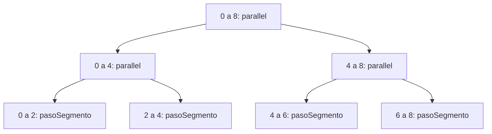

# Informe de paralelización: simulación de partículas

## Punto 1: el paso de la simulación

Un paso de la simulación aplica `mover` a cada una de las $n$ partículas. Cada
partícula se mueve sin mirar a las demás, así que el trabajo se puede repartir
sin coordinación entre los tramos.

```Scala
def pasoSegmento(s: Sistema, dt: Double, desde: Int, hasta: Int): Sistema =
  (for (i <- desde until hasta) yield mover(s(i), dt)).toArray

def pasoSecuencial(s: Sistema, dt: Double): Sistema =
  pasoSegmento(s, dt, 0, s.length)

def pasoParalelo(s: Sistema, dt: Double, umbral: Int): Sistema = {
  val piso = Math.max(umbral, 1)

  def paso(desde: Int, hasta: Int): Sistema =
    if (hasta - desde <= piso) pasoSegmento(s, dt, desde, hasta)
    else {
      val mitad = desde + (hasta - desde) / 2
      val (izquierda, derecha) = parallel(paso(desde, mitad), paso(mitad, hasta))
      izquierda ++ derecha
    }

  paso(0, s.length)
}
```

La versión paralela usa la misma función `pasoSegmento` sobre cada tramo; lo
único que cambia es quién reparte. El tramo se parte por la mitad mientras
tenga más elementos que el umbral, y cada mitad se resuelve sin mirar la otra:
ningún índice aparece en las dos y ninguno se queda por fuera, porque un tramo
va de `desde` a `mitad` y el otro de `mitad` a `hasta`. Los resultados
parciales se combinan con la concatenación, que es asociativa y conserva el
orden porque `izquierda` va siempre antes que `derecha`.

El árbol de llamados para ocho partículas con umbral 2:



Repartir tiene costos propios que la versión secuencial no paga:

* cada partición agrega dos llamados a `paso` y un llamado a `parallel`;
* cada `izquierda ++ derecha` copia los dos arreglos en uno nuevo, porque no se
  puede escribir en una celda de un arreglo ya creado.

Con el umbral igual al tamaño del sistema no se llama a `parallel` y el trabajo
es exactamente el de `pasoSecuencial`: esa es la fila de control.

## Punto 3: las magnitudes globales

Las funciones `energiaParalela` y `centroDeMasaParalelo` dividen recursivamente
el intervalo del sistema en dos mitades mientras el tamaño del segmento sea
mayor que el umbral. Por debajo del umbral se resuelve secuencialmente, y
cuando debe dividirse las dos llamadas recursivas se ejecutan con `parallel`.

Los segmentos izquierdo y derecho son disjuntos y cubren por completo el
segmento original. Por tanto, cada partícula participa exactamente una vez en
el cálculo.

En `energiaParalela`, cada segmento devuelve un `Double` con su energía
parcial, y los valores se combinan con la suma, que es asociativa.

En `centroDeMasaParalelo`, cada segmento devuelve una pareja: la suma de
posiciones ponderadas por masa y la masa total. Las parejas se combinan
sumando sus componentes, operación también asociativa. La división para
obtener el centro de masa se hace una sola vez, al final. Promediar los
centros de cada mitad daría otro resultado cuando las dos mitades no pesan
igual.

## Punto 4: la estimación

Sin ejecutar nada, el punto 4 estima el costo con el trabajo, la profundidad y
el número de procesadores $p$:

```math
\text{trabajo}(n) = n
\qquad
\text{tiempoEstimado}(n, p, u) = \text{profundidad}(n, u) + \frac{\text{trabajo}(n)}{p}
```

La aceleración que predice esa estimación es el trabajo dividido entre el
tiempo estimado:

```math
S_{\text{estimada}} = \frac{\text{trabajo}(n)}{\text{tiempoEstimado}(n, p, u)}
```

## Punto 5: las mediciones

### Cómo se tomaron los tiempos

Los tiempos salen de ScalaMeter con la función `medir`, que descarta las
corridas de calentamiento y devuelve la **mediana de cinco mediciones**, en
milisegundos. La medición está en `App.scala`:

* sistema de **1 000 000 de partículas**, con posiciones, velocidades y masas
  generadas al azar con semilla fija (42), y `dt = 0,5`;
* máquina con **12 núcleos** (`Runtime.getRuntime.availableProcessors`);
* el tiempo secuencial de referencia es el de `pasoSecuencial`: **37,80 ms**;
* la aceleración es `aceleracion(tSecuencial, tParalelo)`, el cociente entre el
  tiempo secuencial y el paralelo, y la estimada es la del punto 4 con $p = 12$.

### Resultados

| Umbral | Tramos | Paralela (ms) | Aceleración | Aceleración estimada |
|---:|---:|---:|---:|---:|
| 1 000 000 | 1 | 37,04 | 1,02 | 0,92 |
| 250 000 | 4 | 27,91 | 1,35 | 3,00 |
| 62 500 | 16 | 34,93 | 1,08 | 6,86 |
| 15 625 | 64 | 28,14 | 1,34 | 10,10 |
| 4 096 | 256 | 27,82 | 1,36 | 11,46 |
| 1 024 | 1 024 | 36,12 | 1,05 | 11,86 |
| 256 | 4 096 | 27,16 | **1,39** | 11,96 |

La columna "Tramos" es el número de hojas del árbol de llamados, es decir, los
trozos que se resuelven en secuencial.

### Lo que dicen los números

**El control responde lo que debía.** Con el umbral igual al tamaño del
sistema la aceleración es 1,02 y la estimada 0,92: no se reparte nada, y las
dos versiones hacen el mismo trabajo. Si esa fila diera una cifra bastante
mayor que 1, la comparación no estaría midiendo el reparto.

**El reparto ayudó poco.** La mejor aceleración medida es 1,39, con 12
núcleos. Pasar de un tramo a cuatro ya da casi todo lo que se gana (1,35), y de
ahí en adelante las filas se mueven entre 1,05 y 1,39 sin una tendencia clara.

**Hay ruido en la medición.** Las filas de 62 500 y de 1 024 tramos están muy
por debajo de las de al lado (1,08 y 1,05 frente a cerca de 1,35), y una
aceleración no baja y vuelve a subir al partir más. Lo más probable es que esas
dos mediciones coincidieran con pausas de la máquina virtual o con otra
actividad del computador. Por eso no se puede decir que un umbral sea mejor que
otro entre los de 1,34 a 1,39: las diferencias están dentro del ruido. Tampoco
se midió la desviación de las cinco corridas, así que no se puede cuantificar.
Por la misma razón, `umbralConveniente` puede devolver cualquiera de ellos en
una corrida dada, incluso el que no reparte.

**La estimación no predice el reloj.** Las dos columnas coinciden donde no se
parte nada y se separan en cuanto se parte: la estimación sube hasta 11,96
mientras la medición se queda en 1,39. La estimación cuenta operaciones y
supone que los 12 núcleos están siempre ocupados y que crear un llamado no
cuesta nada. No incluye lo que cuesta repartir ni el acceso a la memoria.
Sirve como techo y para comparar umbrales entre sí, no como pronóstico.

### Por qué la aceleración es tan baja

Con la aceleración medida de 1,39 sobre 12 núcleos, la ley de Amdahl da la
fracción del cálculo que se comporta como si corriera en serie:

```math
f = \frac{\frac{1}{S} - \frac{1}{p}}{1 - \frac{1}{p}}
  = \frac{\frac{1}{1{,}39} - \frac{1}{12}}{1 - \frac{1}{12}} \approx 0{,}69
```

Con esa fracción el techo es $1/f \approx 1{,}44$, por muchos núcleos que se
agreguen. Los números no dicen de dónde sale esa fracción. Lo que sí se sabe
del código apunta a dos candidatos, que habría que medir por separado para
confirmarlos:

* **La memoria.** Cada paso crea un millón de partículas y de vectores nuevos.
  Con todos los núcleos creando objetos a la vez, el cuello de botella puede
  ser la memoria y el recolector de basura, y no el cálculo, que es una suma y
  un producto por partícula.
* **La concatenación.** Cada `izquierda ++ derecha` copia sus dos arreglos. La
  versión secuencial no lo hace, y con tramos más pequeños hay más niveles de
  copia.

### Conclusión

Con 12 núcleos y un millón de partículas, repartir el paso de la simulación
acelera como máximo 1,39 veces, y la ganancia aparece con pocos tramos. El
control confirma que la versión secuencial y la paralela hacen el mismo
trabajo, y la estimación del punto 4 es un techo muy alejado del resultado
real, porque no cuenta el costo de repartir ni el de la memoria.