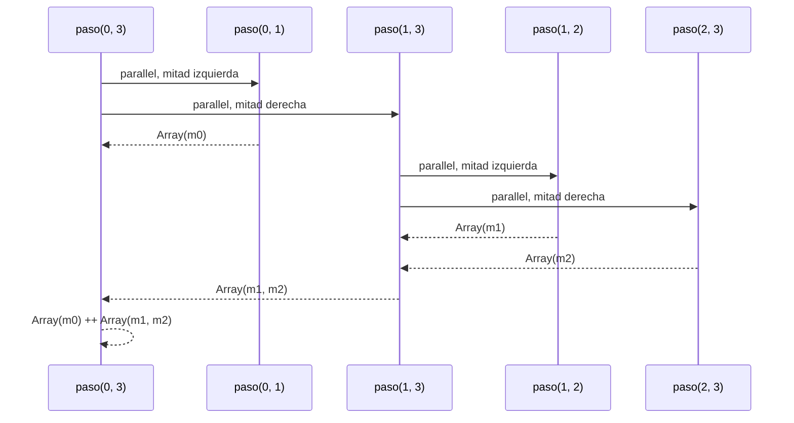
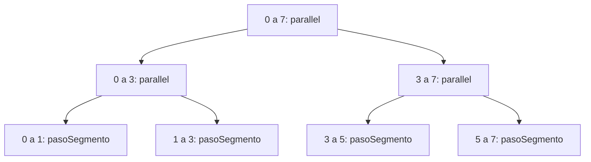
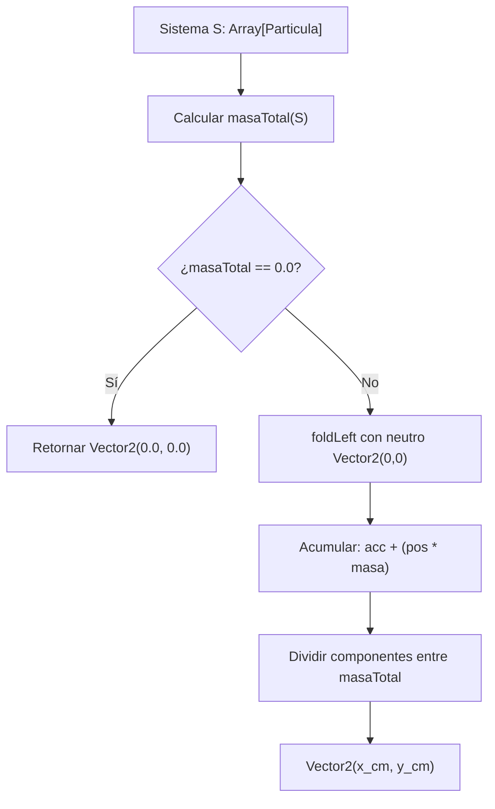
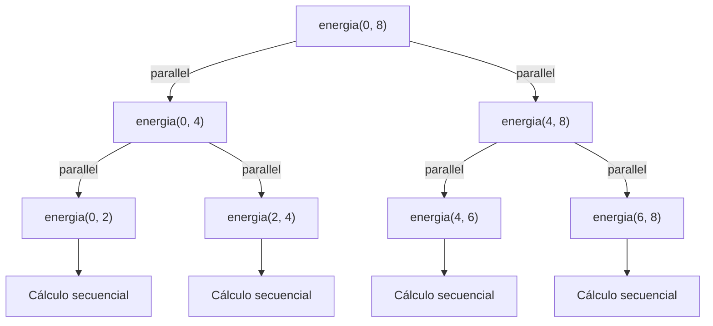
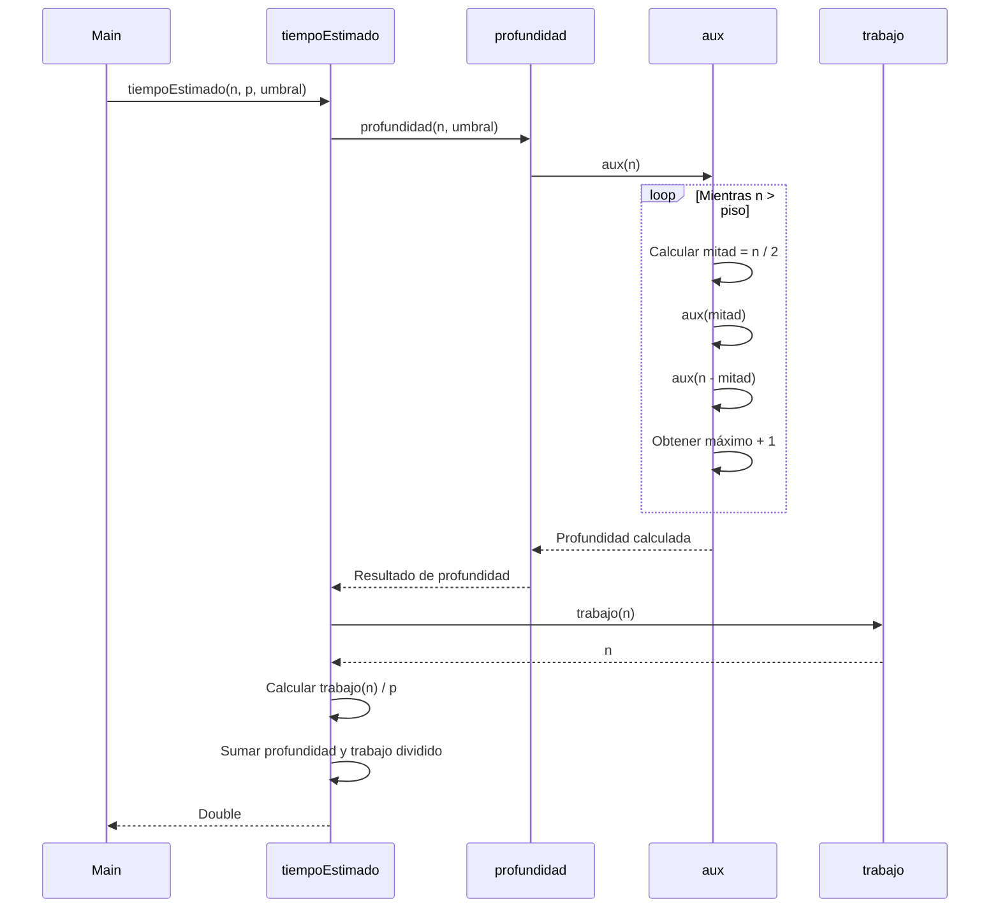

# Informe de Proceso — Taller 4: Simulación de Partículas en Paralelo

## 1. Punto 1: Un paso de la simulación

### 1.1. Definición y enfoque funcional

Un paso de la simulación mueve cada partícula según su velocidad, sin mirar a las demás. Como cada movimiento es independiente, el trabajo se puede repartir entre tramos del sistema.

```scala
def mover(p: Particula, dt: Double): Particula =
  p.copy(pos = p.pos + p.vel * dt)

def pasoSecuencial(s: Sistema, dt: Double): Sistema =
  pasoSegmento(s, dt, 0, s.length)

def pasoSegmento(s: Sistema, dt: Double, desde: Int, hasta: Int): Sistema =
  (for (i <- desde until hasta) yield mover(s(i), dt)).toArray

def pasoParalelo(s: Sistema, dt: Double, umbral: Int): Sistema = {
  val piso = Math.max(umbral, 1)

  def paso(desde: Int, hasta: Int): Sistema =
    if (hasta - desde <= piso) pasoSegmento(s, dt, desde, hasta)
    else {
      val mitad = desde + (hasta - desde) / 2
      val (izquierda, derecha) = parallel(paso(desde, mitad), paso(mitad, hasta))
      izquierda ++ derecha
    }

  paso(0, s.length)
}
```

- `mover`: la posición nueva es $\vec{r}_{nuevo} = \vec{r} + \vec{v} \cdot dt$. `copy` cambia solo `pos`, así que la velocidad y la masa quedan como estaban.
- `pasoSegmento`: aplica `mover` a los índices de `desde` (incluido) a `hasta` (excluido) y devuelve un arreglo **nuevo** con `hasta - desde` partículas. El sistema original nunca se modifica.
- `pasoSecuencial`: es `pasoSegmento` sobre todo el sistema, $[0, n)$. Así la versión secuencial y la paralela hacen el mismo trabajo de la misma forma.
- `pasoParalelo`: parte el sistema por la mitad con `parallel` mientras el tramo tenga más elementos que el umbral. Los tramos que ya no se parten se resuelven con `pasoSegmento`.

### 1.2. Explicación paso a paso de `pasoParalelo`

**El piso del umbral.** `val piso = Math.max(umbral, 1)`. Un tramo de una sola partícula no se puede partir en dos más chicos. Con un umbral de 0 o negativo, la condición nunca se cumpliría y la función se llamaría a sí misma sin terminar. El piso hace que cualquier umbral menor que 1 se comporte como 1.

**Caso base.** Si `hasta - desde <= piso`, el tramo se resuelve en secuencial con `pasoSegmento`. Esto incluye el tramo vacío.

**Caso recursivo.** Se calcula `mitad = desde + (hasta - desde) / 2`. La división entera hace que, si el tramo tiene un número impar de partículas, la mitad derecha quede con una más. Luego `parallel` recibe los dos tramos, $[desde, mitad)$ y $[mitad, hasta)$, y devuelve la pareja de resultados, el de la izquierda primero. Por último, `izquierda ++ derecha` pega los dos arreglos conservando el orden.

### 1.3. Traza con tres partículas y umbral 1

Sea `s = Array(p0, p1, p2)`, `dt = 1.0` y `umbral = 1`. Escribimos `mi` para `mover(pi, dt)`.

1. `paso(0, 3)`: tamaño 3 > 1, se parte con `mitad = 0 + 3/2 = 1`.
2. `parallel(paso(0, 1), paso(1, 3))`.
3. `paso(0, 1)`: tamaño 1 <= 1, es una hoja y da `Array(m0)`.
4. `paso(1, 3)`: tamaño 2 > 1, se parte con `mitad = 1 + 2/2 = 2`, y llama a `parallel(paso(1, 2), paso(2, 3))`.
5. Las dos hojas: `paso(1, 2) = Array(m1)` y `paso(2, 3) = Array(m2)`.
6. Se pega de abajo hacia arriba: `paso(1, 3) = Array(m1, m2)` y `paso(0, 3) = Array(m0, m1, m2)`.

El resultado es el mismo que el de `pasoSecuencial`, y en el mismo orden.



### 1.4. Árbol de llamados con siete partículas y umbral 2

Los tramos con 2 partículas o menos son hojas y se resuelven con `pasoSegmento`. Los demás se parten:



Las hojas cubren $[0,1)$, $[1,3)$, $[3,5)$ y $[5,7)$: $1 + 2 + 2 + 2 = 7$ partículas, cada una en exactamente una hoja. Hay 3 llamados a `parallel`, uno por cada tramo que se parte.

### 1.5. Casos límite

- **Umbral igual al tamaño del sistema (o mayor):** `paso(0, n)` se resuelve de una vez con `pasoSegmento(s, dt, 0, n)`. No se llama a `parallel` y el trabajo es el de `pasoSecuencial`.
- **Umbral 0 o negativo:** el piso lo convierte en 1 y se parte hasta tramos de una partícula.
- **Sistema vacío:** `paso(0, 0)` tiene tamaño 0, no supera el piso y devuelve un arreglo vacío.
---

## 2. Punto 2: Magnitudes Globales (Secuencial)
*(Implementado por iRenly / Georsuans Giraldo)*

### 2.1. Definición y Enfoque Funcional
El Punto 2 calcula las magnitudes físicas fundamentales que resumen el estado global del sistema de partículas, garantizando pureza referencial, inmutabilidad y ausencia de efectos colaterales:

1. **`energiaSecuencial(s: Sistema): Double`**:
   Calcula la energía cinética total del sistema mediante la suma de la energía cinética de cada cuerpo:
   $$E = \sum_{p \in s} \frac{1}{2} m_p \|\vec{v}_p\|^2$$
   Se implementa transformando funcionalmente cada partícula con `map` a su energía escalar $\frac{1}{2} m v^2$ y agregando los valores con `.sum`. Si el sistema está vacío, la suma sobre la colección vacía retorna naturalmente `0.0`.

2. **`masaTotal(s: Sistema): Double`**:
   Calcula la masa escalar agregada de todo el sistema:
   $$M = \sum_{p \in s} m_p$$
   Se implementa proyectando la masa de cada partícula mediante `s.map(_.masa)` y calculando la suma escalar. Para un sistema sin partículas, retorna `0.0`.

3. **`centroDeMasaSecuencial(s: Sistema): Vector2`**:
   Calcula la posición promedio ponderada por la masa de todo el conjunto de partículas:
   $$\vec{R}_{cm} = \frac{1}{M} \sum_{p \in s} m_p \vec{r}_p$$
   - Si la masa total $M = 0$, retorna directamente el vector origen $\vec{0} = (0.0, 0.0)$, previniendo indeterminaciones o divisiones por cero.
   - Si $M > 0$, acumula vectorialmente la suma ponderada $\sum m_p \vec{r}_p$ mediante `foldLeft` partiendo del neutro aditivo `Vector2(0.0, 0.0)` y divide el vector acumulado entre la masa escalar total $M$.

### 2.2. Traza de Ejecución Paso a Paso
Consideremos el sistema físico $S = [p_1, p_2]$:
* $p_1$: $\vec{r}_1 = (0.0, 0.0)$, $\vec{v}_1 = (3.0, 4.0)$, $m_1 = 2.0$ (con $\|\vec{v}_1\| = \sqrt{3^2 + 4^2} = 5.0$).
* $p_2$: $\vec{r}_2 = (4.0, 0.0)$, $\vec{v}_2 = (0.0, 0.0)$, $m_2 = 2.0$ (con $\|\vec{v}_2\| = 0.0$).

#### Traza de `energiaSecuencial(S)`:
1. Elemento 0 ($p_1$): $\frac{1}{2} \cdot 2.0 \cdot (5.0)^2 = 1.0 \cdot 25.0 = 25.0$.
2. Elemento 1 ($p_2$): $\frac{1}{2} \cdot 2.0 \cdot (0.0)^2 = 0.0$.
3. Suma agregada: $25.0 + 0.0 = 25.0$.

#### Traza de `masaTotal(S)`:
1. Elemento 0 ($p_1$): $m_1 = 2.0$.
2. Elemento 1 ($p_2$): $m_2 = 2.0$.
3. Suma agregada: $2.0 + 2.0 = 4.0$.

#### Traza de `centroDeMasaSecuencial(S)`:
1. Cálculo de $M = \text{masaTotal}(S) = 4.0 \neq 0.0$.
2. Inicialización del acumulador en `foldLeft`: `acc = Vector2(0.0, 0.0)`.
3. Paso 1 ($p_1$): `acc = Vector2(0.0, 0.0) + (Vector2(0.0, 0.0) * 2.0) = Vector2(0.0, 0.0)`.
4. Paso 2 ($p_2$): `acc = Vector2(0.0, 0.0) + (Vector2(4.0, 0.0) * 2.0) = Vector2(8.0, 0.0)`.
5. Normalización final: `Vector2(8.0 / 4.0, 0.0 / 4.0) = Vector2(2.0, 0.0)`.

### 2.3. Diagrama de Flujo del Proceso

# Punto 3: las mismas magnitudes en paralelo

## 1. `energiaParalela`

La función recibe el sistema de partículas y un umbral. Primero establece un umbral mínimo de 1 para garantizar que la recursión avance.

La función auxiliar `energia(desde, hasta)` trabaja sobre un segmento del arreglo:

1. Si la cantidad de partículas del segmento es menor o igual al umbral, recorre sus índices y calcula la energía cinética de cada partícula. Luego suma esos valores.
2. Si el segmento supera el umbral, calcula el índice medio y divide el segmento en dos partes: `[desde, mitad)` y `[mitad, hasta)`.
3. Las dos llamadas recursivas se ejecutan mediante `parallel`.
4. Cuando ambas terminan, sus energías parciales se combinan mediante una suma.

Finalmente, se llama a la función auxiliar con el segmento completo, desde `0` hasta `s.length`.

### Ejemplo de ejecución

Considérese un sistema de ocho partículas y un umbral igual a dos.



Cada hoja calcula la energía de su segmento. Los resultados suben por el árbol y se suman hasta obtener la energía total.

## 2. `centroDeMasaParalelo`

Esta función utiliza una estrategia similar de división por mitades, pero cada segmento devuelve una pareja:

- Un `Vector2` con la suma de las posiciones ponderadas por sus masas.
- Un `Double` con la masa total del segmento.

En el caso base, `foldLeft` recorre el segmento y acumula ambos valores. Cuando el segmento supera el umbral, se divide en dos y las llamadas se ejecutan con `parallel`.

Al terminar, se combinan las parejas sumando sus vectores ponderados y sus masas. Después de obtener el resultado del sistema completo, se divide una sola vez la suma ponderada entre la masa total. Si la masa total es cero, se devuelve el origen `Vector2(0, 0)`.

### Ejemplo de combinación

Supóngase que las dos mitades producen:

```text
Mitad izquierda: (Vector2(6, 2), 3)
Mitad derecha:   (Vector2(8, 4), 5)
```

La combinación produce:

```text
(Vector2(14, 6), 8)
```

Y el centro de masa final es:

```text
Vector2(14 / 8, 6 / 8)
```

No se promedian los centros de las dos mitades, porque sus masas pueden ser diferentes.

## Punto 4: Trabajo y profundidad

### Definición del algoritmo - `trabajo`

```scala
def trabajo(n: Int): Int = n
```

La función `trabajo` recibe un entero `n` y devuelve el mismo valor. Representa el número total de operaciones, considerando una operación por partícula.

Recibe un parámetro:

- n: Número de partículas u operaciones.

### Definición del algoritmo - `profundidad`

```scala
def profundidad(n: Int, umbral: Int): Int = {
  require(n >= 0, "El # de operaciones no puede ser negativo.")
  require(umbral > 0, "El umbral debe ser minimo 1.")

  val piso = math.max(umbral, 1)

  def aux(n: Int): Int = {
    if (n <= piso) n
    else {
      val mitad = n / 2
      math.max(aux(mitad), aux(n - mitad)) + 1
    }
  }

  aux(n)
}
```

La función `profundidad` recibe el número de operaciones `n` y un `umbral`. Divide el problema en dos partes hasta que cada parte tenga un tamaño menor o igual al umbral. Devuelve la profundidad máxima de las divisiones, incluyendo el tramo final que queda sin dividir.

Recibe dos parámetros:

- n: Número de operaciones que se deben procesar.

- umbral: Tamaño máximo permitido para dejar de dividir.

### Definición del algoritmo - `tiempoEstimado`

```scala
def tiempoEstimado(n: Int, p: Int, umbral: Int): Double = {
  require(p > 0, "El # de procesadores debe ser mayor a 0.")
  profundidad(n, umbral) + (trabajo(n)/p)
}
```

La función tiempoEstimado recibe el número de operaciones `n`, la cantidad de procesadores `p` y un `umbral`. Devuelve una estimación del tiempo mediante la suma de la profundidad y el trabajo dividido entre los procesadores.

Recibe tres parámetros:

- `n`: Número de operaciones.

- `p`: Cantidad de procesadores disponibles.

- `umbral`: Tamaño máximo de cada tramo antes de dejar de dividir.

### Explicación paso a paso

#### `profundidad( )`

- Se comprueba que n sea mayor o igual a cero y que umbral sea mayor que cero mediante require.

- Se calcula piso con math.max(umbral, 1). Como el umbral ya debe ser positivo, piso tendrá el mismo valor que umbral.

- Se llama a aux(n) para iniciar el cálculo.

- Si n <= piso, se devuelve n, porque el tramo ya no necesita dividirse.

- Si n > piso, se calcula mitad = n / 2.

- Se realizan dos llamadas recursivas:

  - aux(mitad): procesa la primera mitad.

  - aux(n - mitad): procesa la segunda mitad.

- Se toma el mayor resultado de ambas llamadas y se suma uno para contar la división actual.

#### `tiempoEstimado( )`
- Se comprueba que `p` sea mayor que cero mediante require.

- Se llama a `profundidad(n, umbral)` para calcular la profundidad del proceso.

- Se llama a `trabajo(n)` para obtener el número total de operaciones.

- Se divide el `trabajo` entre `p`.

- Se suman ambos resultados y se devuelve el valor como Double.

Importante: Como `trabajo(n)` y `p` son de tipo Int, la división `trabajo(n)/p` es una división entera. Por lo tanto, se descarta la parte decimal antes de sumarla a la profundidad.

### Diagrama de llamados


